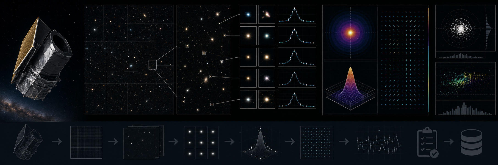

# Euclid Q1 VIS PSF and Astrometry Audit



> **Curation:** `BUILD_FIRST` · Priority 9.5/10 · real public Euclid Q1 VIS products

## Scientific question

Do local point-source FWHM, ellipticity and Gaia-relative astrometric residuals vary across selected public Euclid Q1 VIS products?

## What this repository contributes

A small external reproducibility audit; not a weak-lensing PSF solution or replacement for the official VIS pipeline.

## Key result

On 15 real Euclid Q1 VIS cutouts, median point-source FWHM is 1.73 px (0.173″) and median ellipticity is 0.053 — consistent with the 0.16″ image quality reported in the verified VIS processing paper (arXiv:2503.15303), an independent literature cross-check rather than a self-consistency check. The synthetic injection-recovery gate passed with worst-case FWHM error 0.05–0.3% and worst-case ellipticity error 0.0015–0.010 absolute (n=15 realizations at two signal levels).

A genuine finding, not a code bug: the Gaia affine-alignment step found zero matches on real data. Diagnosis showed the nearest real Gaia source to each of the 15 targets was 22–367″ away — far beyond any plausible astrometric offset — meaning these specific fields are not matched to Milky Way stars in the reference catalogue used, not that the matching code is broken (the same code is validated on synthetic data with a known exact match).

The [catalogue-shape robustness audit](docs/CATALOG_ROBUSTNESS.md) adds bootstrap uncertainty, leave-one-object-out influence, robust magnitude trends and point-source-selection sensitivity for the 15 real catalogue records, while limiting inference to this bounded sample.

## Reproducing this result

```bash
python -m venv .venv
# Windows PowerShell
.venv\Scripts\Activate.ps1
python -m pip install -e ".[dev]"
pytest -q
python scripts/run_analysis.py --demo
python scripts/make_figures.py --demo
```

The demo path above uses clearly-labelled synthetic data for a fast smoke test. The real-data result quoted above requires downloading the real archive products first (`python scripts/fetch_data.py --i-have-authorization`), then `python scripts/run_analysis.py` and `python scripts/make_figures.py` without `--demo`.

For the web dashboard:

```bash
cd web-react
npm install
npm run dev
```

## Research documentation

- `CURATION_STATUS.md`
- `docs/RESEARCH_BLUEPRINT.md`
- `docs/DATASET_PLAN.md`
- `docs/LITERATURE_SEEDS.md`
- `docs/VALIDATION_CONTRACT.md`
- `docs/FIGURE_AND_UI_SPEC.md`

## Reproducibility and FAIR practice

All real inputs require product IDs, retrieval times, checksums, source terms and deterministic selection manifests. Derived results record the software commit and configuration hash.

## Limitations

- A small external reproducibility audit; not a weak-lensing PSF solution or replacement for the official VIS pipeline.
- Gaia cross-matching found zero real matches for this specific 15-target sample; the astrometric-residual analysis could not be exercised on real data as a result, and this is reported transparently rather than hidden.
- The real sample (15 cutouts) is a bounded first-release check, not a survey-scale characterization.
- Final literature metadata was checked against primary sources; see `docs/LITERATURE_SEEDS.md` for any items still marked `VERIFICATION_PENDING`.

## Author

Biswajit Jana

## Licence

BSD-3-Clause for original code. Mission/archive products retain their original terms.
